<h2 data-importer="text" align="left">Hi 👋! My name is Ylian and I'm a game developper, from France</h2>

###

  
  

###

 

###

  
  
  
  
  
  
  
  
  
  
  
  
  
  
  
  
  

###

  
  
  
  

###

###

  

###
